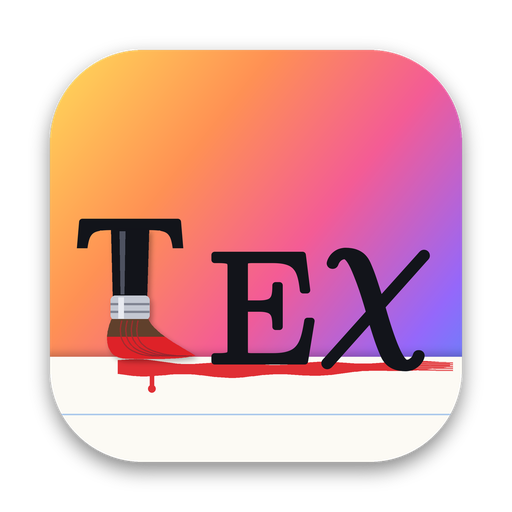

# PainTeX

**Miss Paint from Windows? PainTeX brings it to the Mac, built for engineers.** Paste a screenshot, number it 1, 2, 3, point with arrows, type a note and drop in a LaTeX equation.

> [!TIP]
> **Get PainTeX on the [Mac App Store](https://apps.apple.com/app/id6810508435).** Requires macOS 14 or later.

This repository holds the PainTeX website: **[aiden-azarnoush.github.io/PainTeX](https://aiden-azarnoush.github.io/PainTeX/)**

## What PainTeX does

- **The Paint you know**: brush, pencil, eraser, fill bucket, color picker, shapes, crop, resize, rotate. If you have used Paint on Windows, you already know how it works.
- **Numbered markers**: click, click, click for 1, 2, 3, each number perfectly centered in a circle. Ideal for labeling steps on a screenshot.
- **Arrows**: single and double arrows that snap to 45 degrees with Shift.
- **Text where you click**: no pop-up box, just click and type on the image.
- **LaTeX equations**: click anywhere and type LaTeX with a live preview. Paste straight from a .tex file, including `align`, `cases`, matrices and arrays.
- **Move it later**: drag, nudge, delete or re-edit markers, arrows, shapes, text and equations after placing them.

> [!NOTE]
> PainTeX runs entirely on your Mac and collects no data. See the [privacy policy](https://aiden-azarnoush.github.io/PainTeX/privacy.html).

## Support

Found a bug or have an idea? Open an [issue](https://github.com/aiden-azarnoush/PainTeX/issues) or reach me on [LinkedIn](https://www.linkedin.com/in/aidenazar/).

---

Written by Aiden Azarnoush · [aiden-azarnoush.github.io](https://aiden-azarnoush.github.io)

Dedicated to my mother, Simin Nematpour, my true love.
